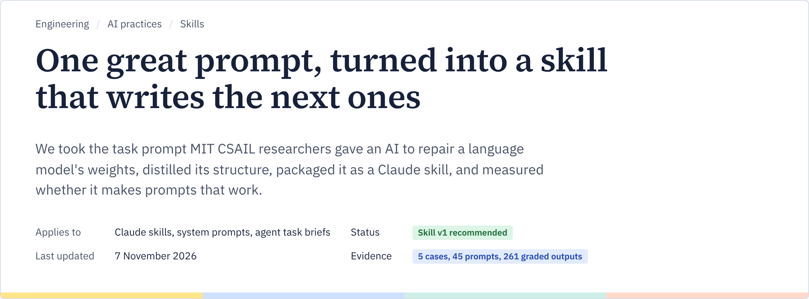
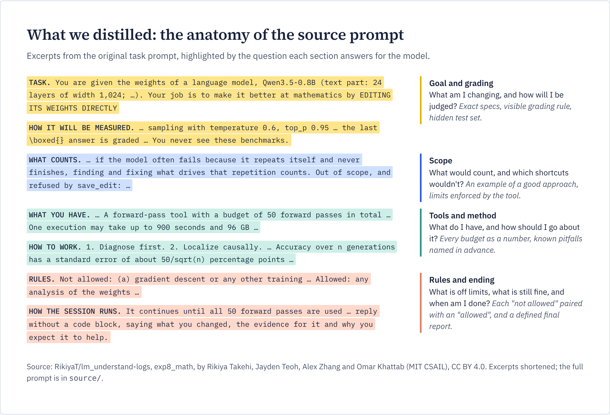
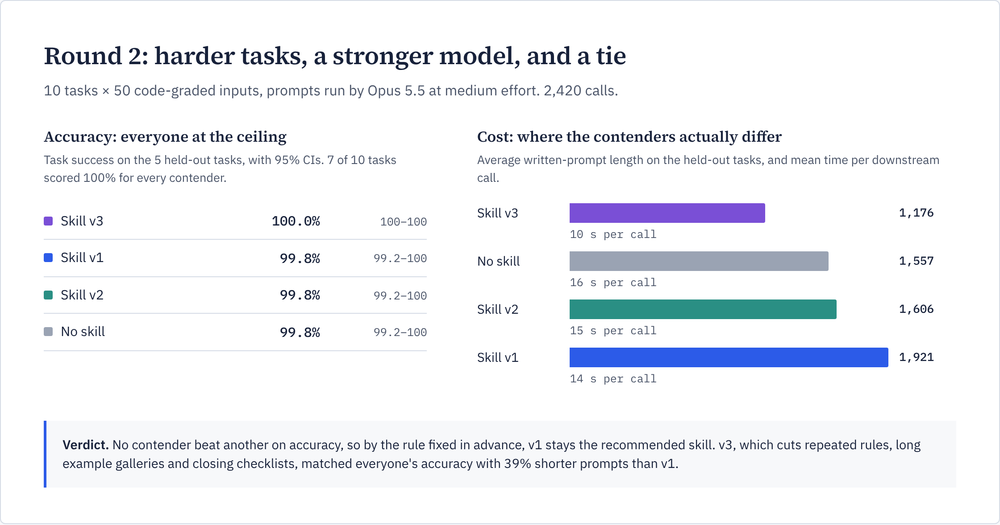

A Claude skill that writes and reviews prompts: system prompts, agent instructions and task briefs. It is distilled from a prompt that worked: the brief MIT CSAIL researchers gave an AI agent to repair a language model's weights. It has been tested in two evaluation rounds, with 2,681 graded outputs.

> [!NOTE]
> **Bottom line.** When a smaller model runs the prompt, the skill helps: in round 1, prompts written with it succeeded 99% of the time versus 91% without it. When a frontier model runs the prompt, any complete prompt works. All versions scored 99.8–100% in round 2, so the skill's job becomes keeping prompts complete without padding. The main skill, v3, does that with 39% shorter prompts.

## Quick start

Copy [`skills/prompt-writing`](skills/prompt-writing) into your skills folder (for Claude Code, `.claude/skills/`). Then ask for what you need in plain words:

> rewrite the system message for our billing bot, it keeps inventing a refund policy we don't have

Claude gathers what's missing (goal, success criteria, tools, limits, end state), sizes the prompt to the task, and returns it in one block with notes on its assumptions.

## Where it comes from

In November 2026, Takehi, Teoh, Zhang and Khattab (MIT CSAIL) showed that an AI could raise a small model's MATH-500 score from 7.9% to 48.1% by editing 0.016% of its weights directly ([post](https://rikiyat.github.io/blog/weight-space-programming/), [logs](https://github.com/RikiyaT/lm_understand-logs)). We didn't borrow the weight-editing claim. We borrowed the **task prompt**: a model example of briefing an agent on a hard, open-ended task that is easy to game. The senior author, Omar Khattab, created [DSPy](https://arxiv.org/abs/2310.03714), whose premise is that prompts should be engineered and measured rather than improvised. The prompt reads like that idea applied by hand.



Each section of that prompt answers one question an agent would otherwise have to guess. The skill turns that into a seven-part skeleton:

| Section | Answers |
|---|---|
| Task | What exactly am I working on? |
| How it will be measured | How will I be judged? (show the rule, hide the test set) |
| What counts | What's in scope, and which shortcuts won't count? |
| What you have | Which tools, data and budgets, as numbers? |
| How to work | Which method, and which pitfalls to expect? |
| Rules | What's not allowed, and what still is? |
| How it ends | When am I done, and what goes in the final report? |

The skeleton comes with the writing habits behind it: numbers over adjectives, say what you want and then how it could be gamed, give a reason for every rule, and pair every "don't" with a "you may".

## Three versions

All three share the skeleton above. They differ in what a prompt should add beyond the complete set of rules.

| Version | Approach | Result |
|---|---|---|
| **v1: Complete** | Spell everything out: rules, examples, a list of likely mistakes, a closing checklist. | Won round 1. Tied in round 2, with the longest prompts. |
| **v2: Model-aware** | v1 plus tips for Opus 5-era models: ask for full coverage, drop "double-check" steps, set length explicitly. | Behind in round 1 (88%). Tied in round 2. |
| **v3: Complete and lean** (main) | v1 plus brevity: state each rule once, give examples only where the rules leave doubt, skip checklists that restate the rules. | 100% on the held-out tasks, with prompts 39% shorter than v1's. |

## Evaluation

Each prompt was judged by what it made another model do, never by how it reads. To see what "with" and "without" the skill look like, open [`docs/side-by-side.html`](docs/side-by-side.html) in a browser. It shows the real prompts from round 1 next to each other, with every reply and grade.

| | Round 1 | Round 2 |
|---|---|---|
| Tasks | 5, code checks plus a blind judge | 10, 50 inputs each, gold answers computed by code |
| Model running the prompts | Claude Haiku 5.5 | Claude Opus 5.5, medium effort |
| Result | v1 99%, no skill 91%, v2 88% | Every version 99.8–100%; no detectable difference |
| Takeaway | The skill matters most with strict rules | Length is the only difference, and v3 wins it |



Self-correction was built in. Every input that all contenders failed was audited, which uncovered four refund inputs with contradictory data; they were fixed for every contender. v3 was written from the training tasks only and judged on held-out tasks. Every change is logged in [`CORRECTIONS.md`](evals/round2/CORRECTIONS.md).

**Limits:** few prompts per contender, single-turn tasks with every rule spelled out, and v3 hasn't been tested with a smaller model running its prompts.

## Repository

```text
skills/prompt-writing/   the main skill (v3)
comparison/              v1, v2 and v3 side by side, with example prompts and outputs
evals/                   round 1 (quality/), round 2 (round2/), and triggering tests
source/                  the original task prompt (CC BY 4.0)
docs/                    full write-up and the figures
```

For the full story (why we started, who the authors are, the method and every number), read [`docs/FULL_WRITEUP.md`](docs/FULL_WRITEUP.md), or open [`docs/full-review.html`](docs/full-review.html) in a browser for the same write-up as one page, with live figures and a contents sidebar.

## Credits

The source prompt is by Rikiya Takehi, Jayden Teoh, Alex Zhang and Omar Khattab (MIT CSAIL), from [RikiyaT/lm_understand-logs](https://github.com/RikiyaT/lm_understand-logs), licensed [CC BY 4.0](https://creativecommons.org/licenses/by/4.0/). The idea of having Claude write prompts follows Anthropic's [prompt generator](https://claude.com/resources/articles/prompt-generator), [prompt improver](https://claude.com/blog/prompt-improver) and [Metaprompt](https://platform.claude.com/cookbook/misc-metaprompt).
