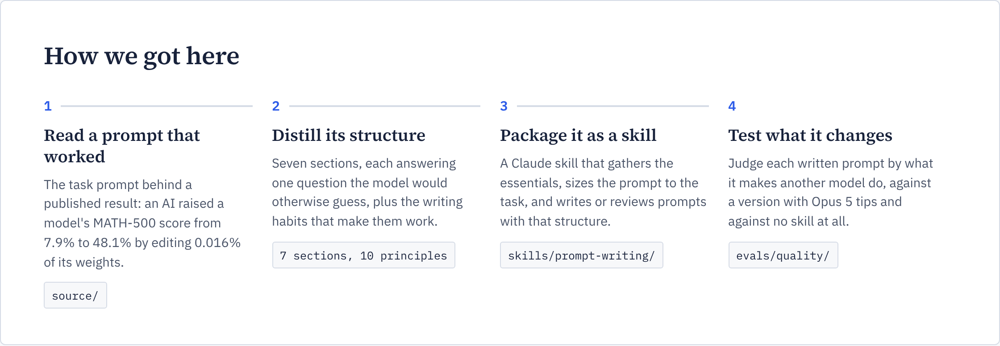
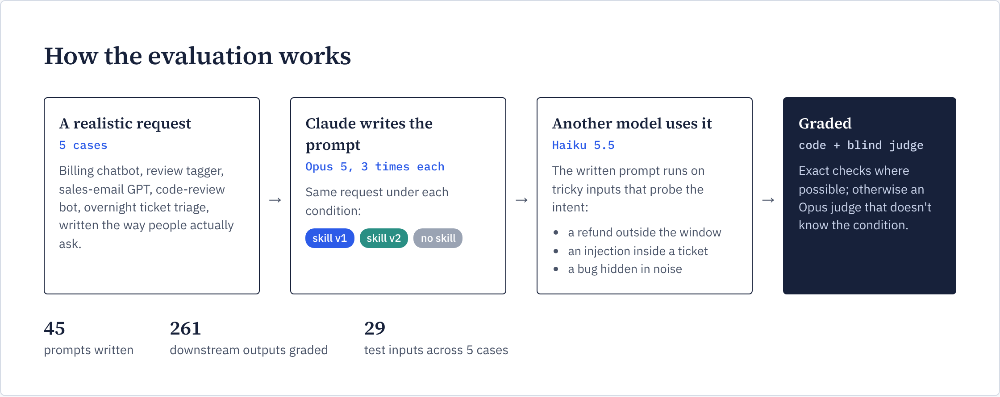
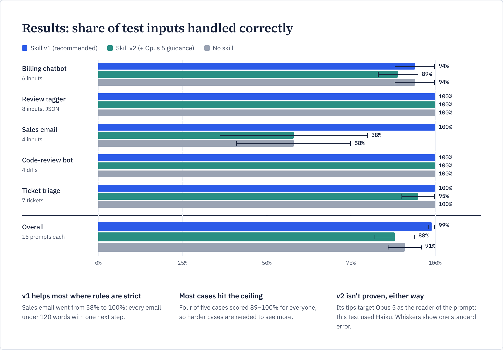

| | |
|---|---|
| **Status** | Skill v1 recommended. Evaluation round 1 complete. |
| **Audience** | Developers who write system prompts, agent instructions or Claude skills |
| **Reading time** | About 10 minutes. If you only have one, read [the summary](#summary). |
| **Last updated** | 7 November 2026 |

> [!NOTE]
> <a id="summary"></a>**Summary.** We took a prompt that produced a striking published result, worked out *why* it is written the way it is, and packaged that pattern as a Claude skill called `prompt-writing`. Then we tested it the hard way. Claude wrote prompts with and without the skill, another model ran those prompts on tricky inputs, and we graded what came out. Prompts written with the skill were handled correctly **99%** of the time, versus **91%** without it. Most of the gain came from one case with strict rules, so treat it as promising rather than proven. Section 7 says exactly what we can and can't conclude.

### On this page

1. [Why we built a prompt-writing skill](#1-why-we-built-a-prompt-writing-skill)
2. [The prompt we learned from](#2-the-prompt-we-learned-from)
3. [Who wrote it, and why we trusted it](#3-who-wrote-it-and-why-we-trusted-it)
4. [What we distilled](#4-what-we-distilled)
5. [The skill, and how to use it](#5-the-skill-and-how-to-use-it)
6. [How we tested it](#6-how-we-tested-it)
7. [What we found](#7-what-we-found)
8. [What's next](#8-whats-next)
9. [What's in this repo](#9-whats-in-this-repo)
10. [Sources and credits](#10-sources-and-credits)



---

## 1. Why we built a prompt-writing skill

Most of us write prompts the way we write a quick Slack message: a goal, a few adjectives ("be thorough", "be helpful"), and hope. When the model misbehaves we add a rule, then another, until the prompt is a pile of patches nobody fully understands.

Anthropic has been steering developers toward a different habit: **let Claude write the prompt**, then test it.

- In May 2024 the Claude Console gained a **prompt generator**. You describe the task, and Claude drafts a production-ready prompt template ([announcement](https://claude.com/resources/articles/prompt-generator)).
- In October 2024 it added a **prompt improver**, which uses Claude to rewrite an existing prompt. Anthropic reported about 30% higher accuracy on a multilabel classification test, and 100% adherence to a word-count target on a summarization test ([announcement](https://claude.com/blog/prompt-improver)).
- The Claude Cookbook ships a **Metaprompt**, a long prompt whose only job is to help Claude write good prompts for a new task ([cookbook](https://platform.claude.com/cookbook/misc-metaprompt)).

Those tools encode Anthropic's general advice. We wanted something more specific: a way of writing that has been shown to hold up when an AI works **alone, for hours, with a real budget and real ways to cheat**. So instead of starting from generic tips, we started from one prompt that demonstrably worked and asked what made it work.

> [!TIP]
> A skill is a folder of instructions Claude loads when a task calls for it. Packaging the pattern as a skill means every developer on the team gets the same structure, without having to remember it.

## 2. The prompt we learned from

On 2 November 2026, four researchers at MIT CSAIL published *[Sparks of Weight-Space Programming: LLMs can natively read & write neural network weights](https://rikiyat.github.io/blog/weight-space-programming/)*. Their claim is that a frontier model can read a neural network's raw weights, understand what the network does, and edit it directly, with no training loop.

The experiment that caught our attention is the eighth one. The researchers gave OpenAI's GPT-6 Astra (the model the post calls "Astra") the weights of a small language model, Qwen3.5-0.8B, and asked it to make the model better at math by editing weights directly. With a budget of 50 forward passes, Astra:

- found that the model mostly failed by **getting stuck in reasoning loops** (85 of its first 96 practice answers hit the 32,768-token limit),
- traced the looping to one direction written by the MLPs in two layers,
- and removed it, changing **0.016% of the weights**.

MATH-500 went from **7.9% to 48.1%** and GSM8K from 13.8% to 67.1%.

The **task prompt** Astra received for that run is what this repo is built on. It is published with the full experiment logs ([RikiyaT/lm_understand-logs](https://github.com/RikiyaT/lm_understand-logs), CC BY 4.0), and a copy is in [`source/`](source/astra_exp8_p50c_prompt.txt).

> [!IMPORTANT]
> We are not claiming the prompt caused the result; the model did the work. What the prompt shows is how to brief an autonomous agent on a hard, open-ended, gameable task. It has a precise goal, a visible grading rule, a hidden test set, hard budgets, named pitfalls, enforced limits and a defined end. That's the part we wanted to reuse.

## 3. Who wrote it, and why we trusted it

The post lists four authors, all at MIT CSAIL: **Rikiya Takehi** and **Jayden Teoh** (marked as joint first authors), **Alex Zhang**, and **Omar Khattab**.

The reason we leaned on this prompt in particular is its senior author.

**Omar Khattab** is an Assistant Professor in MIT's Department of Electrical Engineering and Computer Science and a principal investigator at CSAIL ([MIT EECS](https://www.eecs.mit.edu/people/omar-khattab/), [CSAIL](https://www.csail.mit.edu/person/omar-khattab)). Before MIT he created two widely used systems:

- **[ColBERT](https://arxiv.org/abs/2004.12832)**: a widely used neural retrieval model for matching queries against documents.
- **[DSPy](https://arxiv.org/abs/2310.03714)**: a framework built on the idea that you should not hand-craft prompts at all. You declare what each step of an LLM pipeline should do, and the framework compiles and optimizes the actual prompts against a metric.

That second point is why his name mattered to us. His research argues that instructions to a language model should be **engineered and measured, not improvised**, and this prompt reads like that philosophy applied by hand. Every budget is a number, every interface has an exact format, the grading rule is spelled out, and the known ways to fool yourself are named in advance.

We also trusted it because the evidence is open. The authors published every turn of every run, so the prompt can be read in context alongside what the model did with it.

> [!CAUTION]
> Keep the claims in proportion. The work is a blog post, not a peer-reviewed paper. It relies on one model and small networks, and the authors themselves call the results very early. On a model that rarely loops (Gemma 3 270M), the same approach barely moved the score. We borrowed the *prompt-writing pattern*, not any claim about weight editing.

## 4. What we distilled

Reading the prompt closely, every section answers one question an autonomous agent would otherwise have to guess.


That gives a seven-part skeleton for any multi-step or agentic prompt:

| Section | The question it answers |
|---|---|
| **Task** | What am I working on, exactly? (specs, not adjectives) |
| **How it will be measured** | How will my output be judged? (show the grading rule, even if the test set stays hidden) |
| **What counts** | What's in scope, with one good example, and which shortcuts won't count? |
| **What you have** | Which tools, data and budgets, as numbers, with exact call formats? |
| **How to work** | What method should I follow, and which pitfalls should I expect? |
| **Rules** | What's not allowed, and, just as clearly, what is still allowed? |
| **How the session ends** | When am I done, and what must my final report contain? |

Around the skeleton sit the writing habits that make it work: numbers over adjectives, say what you want and then how it could be gamed, explain the reason for each rule, pair every restriction with a permission, show exact interfaces, name the failure modes, and define "done" up front.

## 5. The skill, and how to use it

The skill lives in [`skills/prompt-writing/SKILL.md`](skills/prompt-writing/SKILL.md). When Claude uses it, Claude will:

1. **Gather the essentials**: objective, success criteria, resources, limits and end state. It asks only about what's missing and matters.
2. **Size the prompt to the task.** A one-shot task (summarize, classify) gets a short prompt with format and examples. Multi-step or agentic work gets the full skeleton.
3. **Write or review** the prompt using the principles above, and flag anti-patterns such as vague quality words, hidden success criteria, ALL-CAPS used instead of explanation, and missing stopping conditions.
4. **Deliver** the prompt in one code block, plus two or three lines on design choices and assumptions to confirm.

**To use it**, add the `skills/prompt-writing` folder as a skill wherever you use Claude (for Claude Code, skills live in a `.claude/skills/` folder). See Anthropic's [skills documentation](https://docs.claude.com) for your setup. Then ask for what you need in plain words, for example "rewrite the system message for our support bot, it keeps inventing policies".

## 6. How we tested it

A prompt can read beautifully and still fail. So we judged each prompt only by **what it makes another model do**.



Step by step:

1. **Five realistic requests**, written the way people actually ask: a billing chatbot that invented a refund policy, a review tagger whose output is parsed with `json.loads`, a sales-email GPT with a strict voice and a 120-word limit, a code-review bot that nitpicks formatting, and an unattended overnight ticket-triage agent.
2. **Claude Opus 5 writes the prompt** three times per request under each of three conditions:
   - **skill v1**: the skill in this repo
   - **skill v2**: v1 plus tips from Anthropic's [Prompting Claude Opus 5](https://platform.claude.com/docs/en/build-with-claude/prompt-engineering/prompting-claude-opus-5) guide
   - **no skill**: the baseline
3. **Claude Haiku 5.5 runs each prompt** on 4 to 8 test inputs built to probe the user's intent. They include a refund request outside the window, a sarcastic review, a prompt injection hidden inside a ticket, an emoji-only review, a demo note with almost no information, and a diff with a real bug among formatting noise.
4. **Grading.** Code checks wherever exactness is possible: valid JSON, identical keys every time, allowed labels, word limit, banned buzzwords. Everywhere else, a blind Claude Opus 5 judge scores each output against a rubric written from the user's request, without knowing which condition produced it.

The full method, every written prompt, every output and every grade are in [`evals/`](evals).

## 7. What we found



| | Skill v1 | Skill v2 | No skill |
|---|---|---|---|
| Overall pass rate | **99% ± 1** | 88% ± 6 | 91% ± 5 |
| Paired difference vs. no skill | **+8.3 ± 5.5 points** | −2.1 ± 6.6 points | — |

**What this tells us**

- **The skill helps most where the rules are strict.** On the sales-email case, prompts written with v1 led to emails that stayed under 120 words with a single next step every time (100%). Without the skill, several emails ran to 125 to 278 words, and the pass rate was 58%.
- **Most of our cases were too easy.** Four of five cases scored 89 to 100% for every condition, so they couldn't tell the conditions apart. The overall gain is about 1.5 standard errors: encouraging, not conclusive.
- **Adding the Opus 5 tips (v2) did not help here, but that isn't a fair verdict on them.** That guide describes how Opus 5 behaves when it *runs* a prompt; our prompts were run by Haiku. v2 did show one real benefit, covered in [`comparison/`](comparison).

> [!WARNING]
> **We corrected three things after the first pass**, and applied each correction to all three conditions:
>
> 1. One test diff we had labelled "clean" actually breaks callers that pass a keyword argument. v2's prompts caught it, which exposed our mistake, so the rubric now accepts that finding.
> 2. One review label ("late, but worth every penny") was debatable, so it now accepts positive or mixed.
> 3. One downstream reply picked up account details from the test environment, and was regenerated.
>
> Details: [`evals/README.md`](evals/README.md).

**Limits.** 3 prompts per case per condition, one downstream model, one judge, and the skill handed to Claude directly rather than discovered on its own. That last point is a separate question, whether Claude picks up the skill unprompted; its test set is in [`evals/triggering/`](evals/triggering).

## 8. What's next

1. **Harder cases.** Long agentic tasks, conflicting constraints, multi-turn conversations: cases where no-skill prompts fail often enough to measure.
2. **More samples.** 8 prompts per case per condition, to bring the error bars under 3 points.
3. **A fair test for v2.** Re-run with Opus 5 as the downstream model, where its tips actually apply.
4. **Triggering.** Measure whether Claude reaches for the skill without being told, and tune the description using Anthropic's `skill-creator`.

## 9. What's in this repo

```text
skills/prompt-writing/      the recommended skill (v1)
comparison/                 v1 vs v2 vs no skill: both skills, side-by-side examples, analysis
evals/quality/              the end-to-end evaluation: cases, harness, every prompt, output and grade
evals/triggering/           test set for "does Claude use the skill on its own?"
source/                     the original task prompt we learned from (CC BY 4.0)
docs/                       the HTML the figures on this page were rendered from, and the images
```

## 10. Sources and credits

- Takehi, Teoh, Zhang, Khattab. [Sparks of Weight-Space Programming](https://rikiyat.github.io/blog/weight-space-programming/), MIT CSAIL, 2 November 2026. Logs and prompts: [RikiyaT/lm_understand-logs](https://github.com/RikiyaT/lm_understand-logs), licensed [CC BY 4.0](https://creativecommons.org/licenses/by/4.0/). The copy in `source/` is unchanged apart from its attribution header.
- Khattab et al. [DSPy: Compiling Declarative Language Model Calls into Self-Improving Pipelines](https://arxiv.org/abs/2310.03714), 2023.
- Khattab and Zaharia. [ColBERT: Efficient and Effective Passage Search via Contextualized Late Interaction over BERT](https://arxiv.org/abs/2004.12832), 2020.
- Anthropic. [Prompt generator](https://claude.com/resources/articles/prompt-generator), [Prompt improver](https://claude.com/blog/prompt-improver), [Metaprompt](https://platform.claude.com/cookbook/misc-metaprompt), [Prompting Claude Opus 5](https://platform.claude.com/docs/en/build-with-claude/prompt-engineering/prompting-claude-opus-5).
